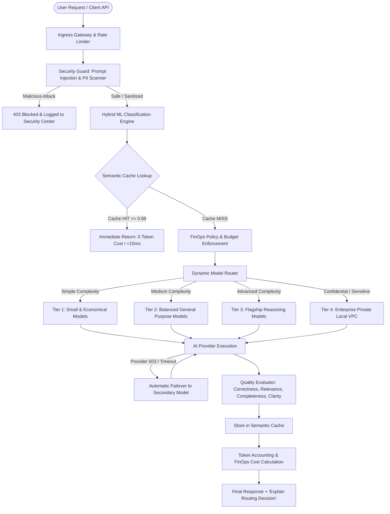

# RouteWise-AI

# SmartRoute AI – Autonomous AI FinOps & Intelligent Model Routing Platform

SmartRoute AI is an enterprise-grade AI Operations (AIOps) and FinOps platform designed to dynamically analyze incoming user queries, assess task complexity, enforce privacy and compliance constraints, automatically select the cost-optimal AI model across configurable tiers, optimize context, evaluate output quality, and monitor provider health in real-time.

---

## Key Highlights & Innovations

- **10-Stage Autonomous Execution Pipeline**: Every user query seamlessly moves through Analysis &rarr; Classification &rarr; Security Inspection &rarr; Policy Verification &rarr; Semantic Cache Check &rarr; Model Routing &rarr; Execution &rarr; Fallback Circuit Breaker &rarr; Quality Evaluation &rarr; Final Transparent Delivery.
- **Hybrid Machine Learning Classifier**: Trained on a multi-domain balanced dataset (650+ labelled samples). Measures and logs real accuracy, precision, recall, F1-scores, and confusion matrices.
- **4 Configurable Model Tiers**:
  - **Tier 1 (Small & Economical)**: Gemini 1.5 Flash, GPT-4o Mini, Llama 3.1 8B Instant ($0.05 - $0.15 / 1M tokens in).
  - **Tier 2 (Balanced General Purpose)**: Gemini 1.5 Pro, Llama 3.3 70B, Claude 3.5 Haiku ($0.60 - $1.25 / 1M tokens in).
  - **Tier 3 (Flagship Reasoning)**: GPT-4o, Claude 3.5 Sonnet, OpenAI o1 ($2.50 - $15.00 / 1M tokens in).
  - **Tier 4 (Enterprise Private / Local VPC)**: Llama 3 70B Private, DeepSeek R1 Local ($0.15 - $0.20 / 1M tokens in).
- **Strict Privacy Firewall**: Automatically detects PII (SSN, credit cards, emails, medical IDs, auth tokens) and prompt injections (DAN patterns, system overrides). Sensitive requests are strictly quarantined to Tier 4 Private VPC models.
- **Sub-Millisecond Semantic Vector Caching**: Deterministic subword and n-gram vector projections with cosine similarity matching. Saves 100% of tokens on repeated queries while honoring privacy boundaries.
- **Context Compression Sandbox**: Strips duplicate log lines and redundant whitespace to minimize prompt bloat before model ingestion.
- **Multi-Model Competition Arena**: Run queries across multiple LLMs side-by-side to crown a FinOps winner based on quality score, latency, and cost efficiency.
- **Dual Runtime Engine**: Full support for both **Live Production Mode** (real OpenAI, Gemini, Groq, Anthropic APIs) and **Deterministic Demo Mode** (rich simulated responses, tokens, and latencies).

---

## Architecture Overview



---

## Technology Stack

- **Frontend**:
  - React 18 + TypeScript + Vite
  - Tailwind CSS with Dark Navy Cyber/Glass Design System
  - Recharts (Interactive Area, Donut, and Bar Charts)
  - Lucide React Icons & Framer Motion
- **Backend**:
  - Python 3.11 + FastAPI + Uvicorn
  - SQLAlchemy 2.0 (SQLite for development, PostgreSQL-ready)
  - Pydantic v2 + Pydantic-Settings
  - Scikit-learn + Joblib (Trained Multi-Target Classifier Pipeline)
  - HTTPX + Python-Dotenv
- **Machine Learning**:
  - 650+ balanced labelled question dataset
  - Stratified Train (80%) / Val (10%) / Test (10%) split
  - Multi-target calibrated Logistic Regression models
  - Structural feature extractors (code syntax, math symbols, stylistic indicators)

---

## Measured ML Classifier Benchmark Metrics

*(Source: `ml/evaluation/metrics.json`)*

| Target Category | Measured Test Accuracy | Weighted F1-Score | Macro F1-Score | Evaluation Test Set |
| :--- | :---: | :---: | :---: | :---: |
| **Complexity** (Simple, Medium, Advanced) | **84.62%** | **84.59%** | **84.61%** | 65 samples (stratified) |
| **Task Type** (8 Domain Classes) | **84.62%** | **85.25%** | **82.76%** | 65 samples (stratified) |
| **Privacy** (Public, Confidential, Sensitive) | **100.00%** | **100.00%** | **100.00%** | 65 samples (stratified) |
| **Priority** (Normal, High, Critical) | **67.69%** | **68.55%** | **67.77%** | 65 samples (stratified) |

---

## 12 Core Platform Modules

1. **Overview Dashboard**: 8 Primary KPI cards (Total Spending, Requests, Tokens Consumed, FinOps Savings, P50 Latency, Successful Outcomes, Quality Score, Active Models), Spending Chart filterable by 24h/7d/30d/90d, Model Donut Chart, Complexity Bars, and Animated 7-Stage Pipeline Visualizer.
2. **AI Playground**: Complete chat interface with real-time automatic classification, pre-flight cost & latency estimation, model selection badge strip, quality scorecard, failure simulation toggle, and the **"Explain Routing Decision"** audit modal.
3. **Model Routing**: Policy configuration sliders (Min Quality, Max Cost, Max Latency), Preferred & Allowed Providers, 4 Tiers Guide, and Pre-Flight Route Simulator.
4. **Workflows**: Real-time tracker for every request's 7 execution stages, duration breakdown, and failed workflow trace inspector.
5. **AI Agents**: Management interface for 6 specialized autonomous background agents (Classification, Routing, Cost Optimization, Quality Evaluation, Security, Monitoring) with live execution activity logs.
6. **Model Registry**: Enterprise registry of models across all 4 tiers with editable token pricing ($ / 1M tokens), quality benchmarks, priority ordering, active toggles, and "Register New Model" modal.
7. **Analytics**: FinOps deep dive, model-wise cost attribution, token consumption trends, cache hit rate, and working **Export CSV** download.
8. **Cost Optimization**: Context Compression Sandbox (measuring original vs optimized tokens and dollar savings) + Semantic Vector Cache Explorer (hit counter, threshold slider, cache purge).
9. **Quality Evaluation**: Multi-Model Competition Arena allowing administrators to benchmark 2 to 4 LLMs side-by-side on identical queries.
10. **Security Center**: Threat audit stream, prompt injection detector (DAN / jailbreak patterns), PII scanner (SSN, credit cards, credentials), and automated sanitization.
11. **Approvals**: Governance workflow for sensitive actions (provider additions, model activations, budget increases, policy updates) with working Approve and Reject buttons.
12. **Settings**: Live Mode vs Demo Mode toggle, Provider credentials manager (Gemini, OpenAI, Groq, Anthropic), connection test buttons, and similarity thresholds.

---

## Installation & Startup Instructions

### Prerequisites
- Node.js (v18+)
- Python (3.10+)

### 1. Backend Setup & Run (Windows PowerShell)

```powershell
# Navigate to project root
cd "C:\Users\lenovo\OneDrive\Desktop\event hack"

# Create and activate virtual environment (optional but recommended)
python -m venv venv
.\venv\Scripts\Activate.ps1

# Install required Python dependencies
pip install -r requirements.txt

# (Optional) Retrain classifier if dataset is modified
python -m ml.training.train_classifier

# Start FastAPI backend server
python -m uvicorn backend.app.main:app --host 127.0.0.1 --port 8000 --reload
```
*The FastAPI backend will automatically initialize SQLite database tables and seed comprehensive initial models, providers, policies, budgets, and historical FinOps telemetry.*

- **Backend API Base**: `http://localhost:8000/api`
- **Interactive Swagger Docs**: `http://localhost:8000/docs`

---

### 2. Frontend Setup & Run (Windows PowerShell)

```powershell
# Open a new terminal in the project root
cd "C:\Users\lenovo\OneDrive\Desktop\event hack"

# Install NPM dependencies
npm.cmd install

# Start Vite React development server
npm.cmd run dev
```

- **Frontend Application**: `http://localhost:5173`

---

### 3. Running Automated Integration Tests

Run the complete 14-point end-to-end integration test suite:

```powershell
python -m backend.tests.test_async_api
```

All 14 tests verify:
- Health check
- Database KPI aggregations
- Hybrid ML classification & calibration
- Route simulation & tier selection
- Live & demo chat execution
- Sensitive data & PII firewall (Tier 4 isolation)
- Anti-jailbreak prompt injection blocking (403 Forbidden)
- Model registry operations
- Multi-model competition arena
- Context optimization compression
- Security event persistence
- Budget limit enforcement
- Approvals governance
- Autonomous agent status streams
